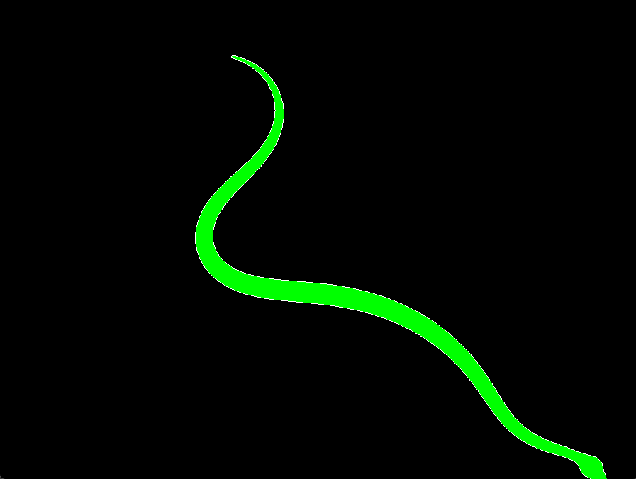

# Procedural Snake

A procedurally animated snake in C++ and SFML. There are no keyframes or
pre-made animation: the whole body is driven by a chain of points that
follows the mouse, and the outline is generated from that chain every frame.

## How it works

- **Distance constraints.** Each segment is pulled to stay a fixed distance
  from the one in front of it. The head follows the cursor, and the rest of
  the body trails behind.
- **Angle constraint.** The bend between neighbouring links is clamped so
  the snake can't fold back on itself. Angle differences are wrapped into
  -pi..pi so the clamp behaves correctly across the atan2 seam.
- **Body outline.** Every spine point gets a left and right point, offset
  90 degrees from its heading by that segment's radius. Radii come from a
  function of position along the body, which gives the taper.
- **Rendering.** The body is filled with a triangle strip (alternating left
  and right points), and the head is a triangle fan.

## Build

Requires SFML 3 and a C++17 compiler (Visual Studio 2022).

1. Open the folder in Visual Studio (File > Open Folder)
2. Visual Studio will auto-detect CMake and configure it
3. Build > Build All

Run it and move the mouse inside the window.

## Project layout

    include/   headers (Segment, Snake)
    src/       implementation and main.cpp

## Credits

Technique from [video title/link] and the
[animal-proc-anim](https://github.com/argonautcode/animal-proc-anim)
repo by argonautcode. This is my own C++/SFML implementation.

## Possible next steps

- Eyes and head details
- Legs using FABRIK inverse kinematics